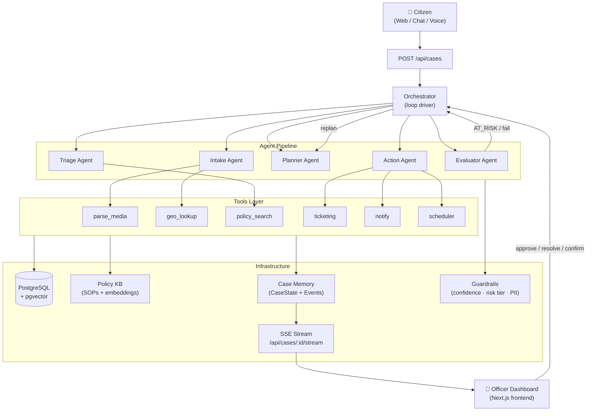

# CivicPilot — Full-Stack Multi-Agent Civic Grievance System

> **Hackathon P4 | Frontend · Docs · E2E**  
> CivicPilot takes a citizen grievance from first report to verified closure using a 6-step agentic loop, 5 specialized agents, 6 real-world tools, and an officer dashboard with live SSE streaming.

---

## Table of Contents

1. [What is CivicPilot?](#1-what-is-civicpilot)
2. [Architecture](#2-architecture)
3. [Team Breakdown](#3-team-breakdown)
4. [Environment Variables](#4-environment-variables)
5. [Setup Instructions](#5-setup-instructions)
6. [Running Locally](#6-running-locally)
7. [Running Demo Scenarios](#7-running-demo-scenarios)
8. [Deployment](#8-deployment)

---

## 1. What is CivicPilot?

CivicPilot is a multi-agent AI system that handles public-service complaints end-to-end:

| Dimension | Detail |
|---|---|
| **Agents** | Orchestrator, Intake, Triage, Planner, Action, Evaluator (5 task agents + orchestrator) |
| **Loop** | perceive → reason → plan → act → evaluate → adapt |
| **Tools** | `parse_media`, `geo_lookup`, `policy_search`, `ticketing`, `notify`, `scheduler` |
| **Domains** | Water, Roads, Sanitation, Electricity, Parks, Public Health |
| **Guardrails** | Confidence threshold (0.65), risk-tiered approval, PII masking, full audit trail |
| **Status lifecycle** | NEW → INTAKE → TRIAGED → PLANNED → IN_PROGRESS → AT_RISK / NEEDS_HUMAN → AWAITING_CONFIRMATION → CLOSED / REOPENED |

### The 6-Step Agentic Loop

```
Citizen files report
        │
  ① PERCEIVE   – Intake agent calls parse_media, geo_lookup
        │
  ② REASON    – Triage agent calls policy_search, computes urgency/confidence
        │
  ③ PLAN      – Planner builds step-by-step plan with fallbacks & risk tiers
        │
  ④ ACT       – Action agent dispatches tickets, notifies crew, schedules checks
        │
  ⑤ EVALUATE  – Evaluator checks outcomes against SLAs and policy
        │
  ⑥ ADAPT     – Orchestrator detects AT_RISK / failures → Planner replans
        │
  Citizen confirms closure  ──────────────────────────────► CLOSED
```

### Five Agents

| Agent | Role |
|---|---|
| **Orchestrator** | Drives the loop; calls `start_case`, `resume_case`, routes signals |
| **Intake** | Parses text + images, geocodes location, extracts category and missing info |
| **Triage** | Assigns urgency, department, ward, SLA deadline; queries policy KB |
| **Planner** | Builds an ordered plan of tool calls with dependencies, fallbacks, risk tiers |
| **Action** | Executes plan steps: creates tickets, assigns crews, sends notifications |
| **Evaluator** | Checks step results against expected outcomes; flags AT_RISK or success |

### Six Tools

| Tool | Purpose |
|---|---|
| `parse_media` | LLM-powered extraction from text + images |
| `geo_lookup` | Reverse geocoding → ward, office, coordinates |
| `policy_search` | Semantic search over SOPs (pgvector) |
| `ticketing` | Create / assign / update tickets and crews |
| `notify` | SMS, email, chat notifications to citizens and crews |
| `scheduler` | Schedule / cancel follow-up timer checks |

---

## 2. Architecture



---

## 3. Team Breakdown

| Part | Owner | Scope |
|---|---|---|
| **P1** | Backend / API / Tools | `backend/app/main.py`, `api/`, `db/`, `tools/` (geo, ticketing, notify, scheduler), `sandbox/`, `core/`, `schemas.py`, `.github/`, `docker-compose.yml` |
| **P2** | LLM / KB / Agents | `backend/app/llm/`, `tools/parse_media.py`, `tools/policy_search.py`, `agents/intake.py`, `agents/triage.py`, `agents/planner.py`, `kb/` |
| **P3** | Orchestration / Eval / Scenarios | `orchestrator/`, `agents/action.py`, `agents/evaluator.py`, `adaptation/`, `guardrails/`, `scenarios/`, `eval/` |
| **P4** | Frontend / Docs / E2E | `frontend/`, `docs/`, `e2e/` *(this document)* |

---

## 4. Environment Variables

All variables come from `docs/CONTRACT.md` §8 and `.env.example`.

### Backend Variables

| Variable | Default | Description |
|---|---|---|
| `GEMINI_API_KEY` | *(required)* | Google Gemini API key |
| `GEMINI_MODEL` | `gemini-1.5-pro` | Chat / reasoning model |
| `GEMINI_EMBED_MODEL` | `text-embedding-004` | Embedding model for KB |
| `MOCK_LLM` | `false` | `true` → use fixtures, no Gemini key needed |
| `CONFIDENCE_THRESHOLD` | `0.65` | Below this → `NEEDS_HUMAN` |
| `DATABASE_URL` | `postgresql+asyncpg://...` | PostgreSQL + pgvector connection string |
| `SUPABASE_URL` | *(optional)* | Supabase project URL (for image storage) |
| `SUPABASE_SERVICE_KEY` | *(optional)* | Supabase service role key |
| `JWT_SECRET` | *(required)* | 32+ char secret for officer JWT |
| `OFFICER_PASSWORD` | `adminpassword` | Password for `/api/auth/login` |
| `SIM_TIME_SCALE` | `1` | `60` = 1 minute simulates 1 hour (demo acceleration) |
| `NOMINATIM_USER_AGENT` | `CivicPilot/1.0 (...)` | Required by OpenStreetMap ToS |
| `RESEND_API_KEY` | *(optional)* | Email notifications via Resend |
| `FRONTEND_ORIGIN` | `http://localhost:3000` | CORS allowed origin |

### Frontend Variables

| Variable | Default | Description |
|---|---|---|
| `NEXT_PUBLIC_API_URL` | `http://localhost:8000` | Backend base URL |
| `NEXT_PUBLIC_USE_MOCKS` | `false` | `true` → use MSW mock service worker (no backend needed) |

---

## 5. Setup Instructions

### Prerequisites

- **Node.js** 18+ and npm 9+
- **Python** 3.11+
- **Docker** (for the full local stack)
- A **Google Gemini API key** (or use `MOCK_LLM=true` for offline development)

### Backend (Python venv)

```bash
# 1. Clone the repo
git clone <repo-url> civicPilot
cd civicPilot

# 2. Create and activate virtual environment
python -m venv .venv
source .venv/bin/activate        # Windows: .venv\Scripts\activate

# 3. Install dependencies
pip install -e ".[dev]"           # or: pip install -r requirements.txt

# 4. Copy and configure environment
cp .env.example .env
# Edit .env — set GEMINI_API_KEY, JWT_SECRET, OFFICER_PASSWORD at minimum

# 5. Start the database (Docker)
docker compose up db -d

# 6. Run migrations and seed data
python -m backend.app.db.init_db

# 7. Ingest policy knowledge base
python -m kb.ingest
```

### Frontend (npm)

```bash
cd frontend

# Install dependencies
npm install

# Configure environment
cp .env.local.example .env.local
# Set NEXT_PUBLIC_API_URL and NEXT_PUBLIC_USE_MOCKS

# Start dev server
npm run dev
# → http://localhost:3000
```

### Full Stack with Docker Compose

```bash
# From repo root — spins up PostgreSQL + pgvector + FastAPI backend
docker compose up --build

# API available at http://localhost:8000
# Health check: curl http://localhost:8000/api/health
```

> **Note**: The Docker Compose stack does not include the Next.js frontend.  
> Run `npm run dev` in the `frontend/` directory separately, or deploy to Vercel.

---

## 6. Running Locally

### Backend + Frontend (Full Mode)

```bash
# Terminal 1 — Start database
docker compose up db -d

# Terminal 2 — Start backend API
source .venv/bin/activate
uvicorn backend.app.main:app --reload --port 8000

# Terminal 3 — Start frontend
cd frontend && npm run dev
```

Open http://localhost:3000 in your browser.

**Officer login**: use the password set in `OFFICER_PASSWORD` (default: `adminpassword`).

### Frontend Mock Mode (No Backend Required)

```bash
cd frontend

# Enable mock service worker
echo "NEXT_PUBLIC_USE_MOCKS=true" > .env.local
echo "NEXT_PUBLIC_API_URL=http://localhost:8000" >> .env.local

npm run dev
```

In mock mode, [MSW](https://mswjs.io/) intercepts all API calls and returns realistic fixture data including:
- 5 pre-seeded cases at different lifecycle stages
- Case 1042 (critical high-voltage emergency)
- 20+ events per case showing the full perceive→adapt loop
- Simulated SSE streaming with live event updates
- Realistic 200–800 ms response delays

---

## 7. Running Demo Scenarios

The backend ships with four pre-defined scenarios runnable via REST or the demo control panel in the officer dashboard.

### Via the Officer Dashboard

1. Log in at http://localhost:3000/officer/login
2. Navigate to **Demo Controls** (`/officer/demo`)
3. Select a scenario and click **Run**

### Via REST API

```bash
# Happy Path — water leak, urgent
curl -X POST http://localhost:8000/api/demo/scenarios/happy/run \
  -H "Authorization: Bearer <officer-token>"

# Disruption — road pothole, ticket rejected
curl -X POST http://localhost:8000/api/demo/scenarios/disruption/run \
  -H "Authorization: Bearer <officer-token>"

# Ambiguity — vague report, confidence below threshold
curl -X POST http://localhost:8000/api/demo/scenarios/ambiguity/run \
  -H "Authorization: Bearer <officer-token>"

# Case 1042 — critical high-voltage wire near school
curl -X POST http://localhost:8000/api/demo/scenarios/case1042/run \
  -H "Authorization: Bearer <officer-token>"
```

### Via Python CLI

```bash
# From repo root with venv active
python -m scenarios.run happy
python -m scenarios.run disruption
python -m scenarios.run ambiguity
python -m scenarios.run case1042
```

### Scenario Summary

| Scenario | Report | Key Demo Point |
|---|---|---|
| `happy` | Water leak, urgent | Shows the nominal 6-step loop end-to-end |
| `disruption` | Road pothole | Shows adaptation after ticket rejection |
| `ambiguity` | Vague noise complaint | Shows guardrail → NEEDS_HUMAN → officer resolve |
| `case1042` | High-voltage wire near school | Shows critical risk tier → supervisor approval flow |

### Accelerating the Demo Clock

For live demos, set `SIM_TIME_SCALE=60` in the backend environment. This makes 1 real minute equal to 1 simulated hour, so multi-hour SLA deadlines play out in seconds.

---

## 8. Deployment

See **[DEPLOY.md](DEPLOY.md)** for full deployment instructions covering:

- Supabase PostgreSQL + pgvector setup
- Render web service (backend)
- External cron for SLA timers (cron-job.org / UptimeRobot)
- Vercel frontend deployment
- Custom domains and preview deployments for PRs
- Local Docker Compose for development
