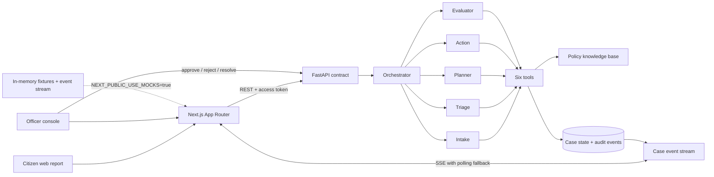

# CivicPilot

CivicPilot takes a public-service grievance from report to verified resolution through an auditable multi-agent workflow. The UI supports citizens filing and tracking cases, officers monitoring live execution, risk-tiered approvals, a sandbox demo, and evaluation reporting.

The shared API and data contract is [CONTRACT.md](CONTRACT.md). It is authoritative; this frontend consumes its routes and does not change it.

## Product loop

**Perceive → Reason → Plan → Act → Evaluate → Adapt**

The loop is driven by one orchestrator with five specialist agents: Intake, Triage, Planner, Action, and Evaluator. It uses six tools: `parse_media`, `geo_lookup`, `policy_search`, `ticketing`, `notify`, and `scheduler`. Confidence thresholds, risk-tiered approvals, audit events, and PII masking are cross-cutting guardrails.

## Architecture



## Frontend routes

- `/` — product overview, six-step loop, architecture, report and officer entry points.
- `/report` — citizen intake with text, photo, location pin/address, language, and optional speech input; provides a private tracking link after submission.
- `/track/[id]?token=…` — reopens a case using the case access token, shows status/events/notifications, accepts follow-up evidence, and confirms or disputes closure.
- `/officer/login` — officer password login; the one-click demo login is available only in mock mode.
- `/officer/cases` — filtered queue and global open/at-risk/needs-human/closed counters.
- `/officer/cases/[id]` — event timeline, tool payloads, plan, confidence, policy citations, case location/tickets, and sandbox actions.
- `/officer/approvals` — pending approval and needs-human queues.
- `/officer/demo` — run Happy Path, Disruption, Ambiguity, or Case 1042; inspect returned case IDs and send sandbox signals.
- `/officer/metrics` — six outcome slots populated only from returned summary/evaluation data. Missing values are shown as unavailable, never filled with illustrative numbers.

## Requirements

- Node.js 20+ and npm
- For live mode: the CivicPilot API from this repository and an officer password
- For browser tests: Playwright Chromium (see [E2E](#end-to-end-tests))

## Local setup and run

### Frontend only (no backend)

```sh
cd frontend
npm install
printf 'NEXT_PUBLIC_USE_MOCKS=true\nNEXT_PUBLIC_API_URL=http://localhost:8000\n' > .env.local
npm run dev
```

Open <http://localhost:3000>. Mock mode uses realistic in-memory case, event, approval, and sandbox fixtures; it does not use MSW and does not require the API. Mock data resets when the app process reloads. Metrics remain empty until a real API reports them.

### Live API

Start the API as described in the repository setup instructions, then configure the frontend:

```dotenv
NEXT_PUBLIC_USE_MOCKS=false
NEXT_PUBLIC_API_URL=http://localhost:8000
```

Set these values before building. The API's `FRONTEND_ORIGIN` must allow the frontend origin. Officer routes require the JWT returned by `POST /api/auth/login`. Citizen case requests use the access token returned by `POST /api/cases`; the copied `/track/[id]?token=…` link carries it when reopening a case.

### Checks

```sh
cd frontend
npm run lint
npm run build
```

The frontend API functions and TypeScript models are maintained from [CONTRACT.md](CONTRACT.md). No OpenAPI schema is included in the shared contract, so the client is typed against those declared routes and shapes rather than generated from a separate spec.

## Environment variables

| Variable | Frontend use |
|---|---|
| `NEXT_PUBLIC_USE_MOCKS` | `true` enables in-memory fixtures; `false` uses the REST API. Defaults to live mode. |
| `NEXT_PUBLIC_API_URL` | API origin; defaults to `http://localhost:8000`. |

Backend environment variables are documented in the root [`.env.example`](../.env.example) and [CONTRACT.md §8](CONTRACT.md#8-env-vars-envexample-is-the-source-of-truth-p1-maintains).

## Demo scenarios

Follow the [minute-by-minute demo script](DEMO.md). In mock mode the scenarios use seeded cases 1001, 1002, 1003, and 1042. The live API returns a new case ID for each scenario; use the case link displayed in the demo panel. The simulated deadline clock is controlled by backend `SIM_TIME_SCALE`; the frontend labels it as backend-configured because the contract does not expose a clock-read endpoint.

## End-to-end tests

```sh
cd e2e
npm install
npx playwright install chromium
npm test
```

Tests default to the frontend's mock mode so they run without a backend. To run against a deployed/local live stack, set `PLAYWRIGHT_TEST_BASE_URL`, `E2E_USE_MOCKS=false`, and `E2E_OFFICER_PASSWORD` in the test environment. See [e2e/README.md](../e2e/README.md).

## Deployment

See [DEPLOY.md](DEPLOY.md#5-frontend-deployment-vercel). Import the repository in Vercel with `frontend` as the root directory. Configure `NEXT_PUBLIC_API_URL` and `NEXT_PUBLIC_USE_MOCKS=false` for production, and set backend `FRONTEND_ORIGIN` to the Vercel URL. Preview deployments can use mock mode.

## Team ownership

| Part | Scope |
|---|---|
| P1 | Backend REST/SSE, database, auth, tools, infrastructure |
| P2 | LLM, media/policy tools, intake/triage/planning, knowledge base |
| P3 | Orchestration, action/evaluation, guardrails, adaptation, scenarios |
| P4 | `frontend/`, `docs/`, and `e2e/` |

See [CONTRACT.md §2](CONTRACT.md#2-repo-layout-and-owners) for the shared ownership map and [CODEOWNERS](../CODEOWNERS) for review rules.
